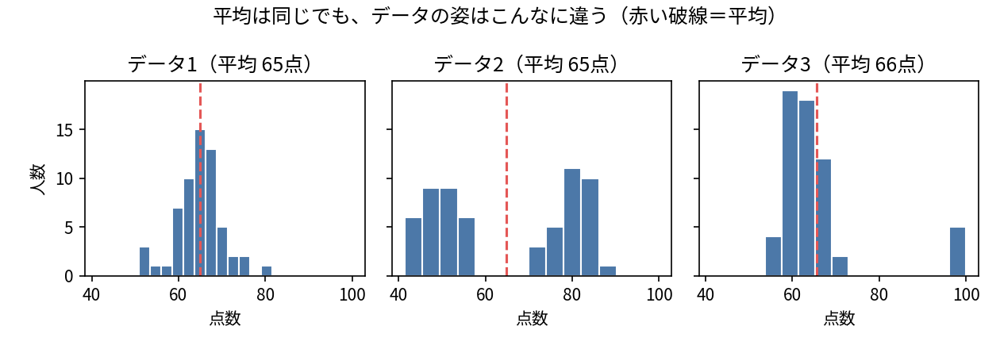

# 第1コマ　データ可視化（導入編）

::: {.content-visible unless-format="revealjs"}
このコマの進め方：講義（40分）→ 図を見て姿を言葉にする演習（40分）→ まとめ（10分）。
このコマではまだプログラムは書きません。第2コマから Thonny で手を動かします。
:::

## この講座で目指すこと

1. 平均などの数字だけでは、データの姿は分からない
2. 表の読み方・作り方を知ると、グラフが読みやすくなる
3. グラフは「知りたいこと」に合わせて選ぶ
4. 最後は、自分の気づきをグラフだけで納得させられるようになる

## 次の2日間の流れ

- 1日目：第1コマ 導入 → 第2コマ Python入門 → 第3コマ データと尺度 → 第4コマ 表のいろいろ
- 2日目：第5コマ グラフのいろいろ → 第6コマ データ分析 → 第7コマ データ集めの設計 → 第8コマ テスト

## 例：平均が同じでも、姿はまったく違う

3つのクラスは、平均点がどれも約65点です。テストの点数をグラフ（ヒストグラム）にすると、姿はこんなに違います。

平均（要約）だけ見ていては、山の高さ、広がり、偏りといった「姿」は分かりません。グラフで見るからこそ、姿が見えます。

::: {.callout-note}
この図は講師がプログラムで描いたものです。作り方は講座の中で少しずつ身につけます。
:::

## グラフが力を発揮する場面

- たくさんの数を一度に比べたいとき（表は縦に長いと読みにくい）
- 時間の流れや変化を見たいとき
- 「なんとなく多そう」という感覚を、人に納得させたいとき

## 逆に、グラフが向かない場面

- 正確な数値そのものを伝えたいとき（例：請求書の金額）は、表や数字のほうがよい
- データが数件しかないときは、数字をそのまま書くほうが伝わる

## 演習：図を見て、姿を言葉にする（ペアで40分）

1. 配られた3種類の図（ヒストグラム／箱ひげ図／散布図）をペアで眺める
2. それぞれについて、「どんな姿か」を一文で書く。数字の暗記ではなく、言葉で表す練習
   - 例：「真ん中に山が1つあって、右に長くすそを引いている」
   - 例：「2つのグループは重なっている部分が大きい」
3. ペアで読み合い、相手に伝わる表現だったかを確かめる

## まとめ

- 平均などの要約だけでは、データの姿は分からない
- グラフは、姿を見せ、感覚を「納得」に変える道具
- ただし正確な数値には表の出番もある。使い分けが大事

次回は Thonny を準備して、最初のプログラムを実行します。
