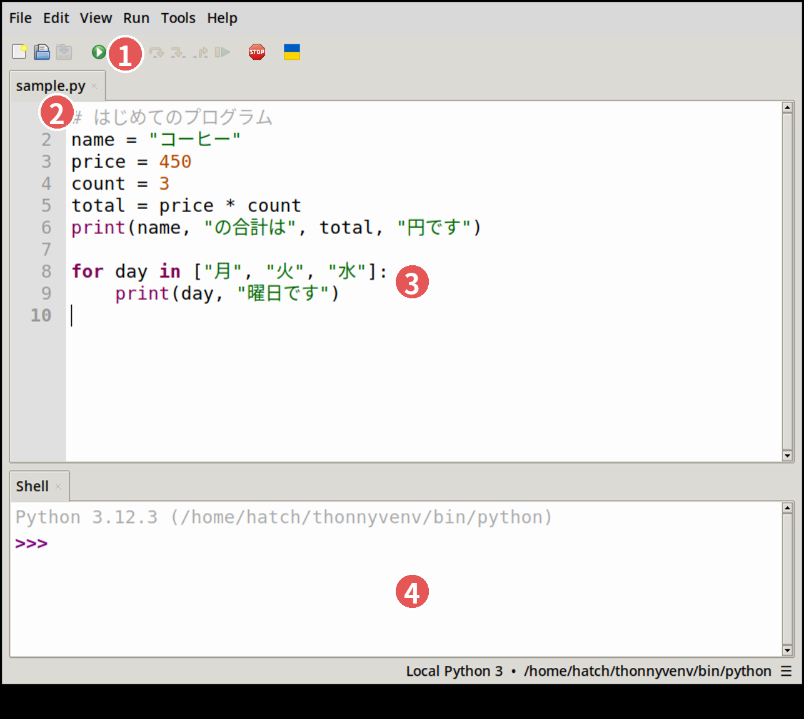

# 第2コマ　Python入門

::: {.content-visible unless-format="revealjs"}
このコマの進め方：Thonny の準備と画面説明（25分）→ 講義と一緒に実習（55分）→ まとめ（10分）。
:::

## Thonny の準備

- Thonny は、Python 本体と編集画面が一緒になった初心者向けの無料ソフトです（thonny.org）
- Windows へのインストールは、ターミナル（コマンド プロンプト）で次を実行してください

```text
winget install AivarAnnamaa.Thonny
```

- うまくいかない場合は、公式サイト thonny.org からダウンロードしてください
- 起動したら、この後に出てくる短いプログラムをそのまま実行してみましょう

## Thonny の画面



1. **実行ボタン**（緑の三角）。押すとプログラムが実行されます（F5キーでも同じ）
2. **ファイルのタブ**。開いているプログラムの名前が出ます
3. **編集エリア**。ここにプログラムを書きます
4. **シェル**。実行結果や、エラーのメッセージが表示されます

（画面は Thonny 5.0 で撮影したものです。表示は設定で少し違うことがあります）

## 基本の使い方：4つのステップ

1. **書く**：編集エリアにプログラムを書く
2. **保存する**：Ctrl+S。名前は「session2.py」のように、末尾が `.py` になるようにします
3. **実行する**：緑の三角ボタン、または F5キー
4. **結果を見る**：文字の結果はシェルに、グラフは新しいウィンドウに表示されます。エラー（赤い文字）が出たら、シェルの一番下の行がヒントです

追加の部品（pandas や matplotlib-fontja）は、メニューの「ツール → パッケージを管理」から入れることができます。第3コマ以降で使います。

## データのダウンロード（実習の前に）

- 実習で使うデータは、あらかじめ固めてある **data.zip をダウンロード**してください
- 配布ページ（data.zip）：https://github.com/helmenov/lecture-dataviz/blob/main/data.zip
- ページ右側のダウンロードボタンで落とし、**展開（解凍）すると data フォルダが出てきます**
- **置き場所**：ドキュメントフォルダの中に講義用のフォルダ（例：dataviz）を作り、その中に code フォルダと**並べて**置きます

```text
ドキュメント/dataviz/     ← 講義フォルダ(自分で作る)
  code/    プログラム(session1.py など)
  data/    ダウンロードしたデータ(csv ファイル)
```

- プログラムは、隣の data フォルダからデータを読みます。**フォルダの並びを崩すと、データが見つからずエラーになります**
- zip で配られている場合は、展開（解凍）してから置いてください。ダウンロードフォルダに置いたままにしないこと
- テスト用のデータ（test_psych.csv）も data フォルダに入っています。第8コマで使います

## Python は「計算と指示」ができる電卓

- プログラムは、上から順に実行されます
- `#` の後ろはコメント（説明書き）で、実行されません
- まずは `print()` で、計算の答えを表示してみます

```{python}
print("こんにちは")
print(3 + 4)          # 足し算
print(120 * 1.1)      # 消費税込みの価格
```

（本の中では、このようなプログラムの実行結果もその場で表示されます）

## 変数：名前のついた箱

```{python}
price = 120           # 変数 price に 120 を入れる
tax = 1.1
print(price * tax)    # 箱の中身を使って計算する
price = 150           # 入れ直すこともできる
print(price * tax)
```

## リストと辞書

```{python}
scores = [72, 65, 80, 91]   # リスト: 並んだデータ
print(len(scores))          # 個数
print(sum(scores) / len(scores))  # 平均

person = {"名前": "田中", "点数": 72}  # 辞書: 名前付きのデータ
print(person["名前"], person["点数"])
```

## 繰り返しと条件分岐

```{python}
for s in [72, 65, 80, 91]:   # リストの中身を1つずつ取り出す
    if s >= 80:
        print(s, "よくできました")
    else:
        print(s, "もう少し")
```

## 関数とライブラリ

- よく使う処理には名前が付いていて、呼び出すだけです（例：`print`、`len`、`sum`）
- 追加の道具箱が「ライブラリ」。`import` で読み込んで使います
- この講座では、表とグラフの道具箱 **pandas** を中心に使います

## 演習

1. 自分の名前と、今日の日付を `print` で表示する
2. リストに家族の年齢を入れて、平均を出す
3. 80点以上なら「合格」、それ以外は「再挑戦」と表示するプログラムに書き換える

## まとめ

- プログラムは上から順に実行される。結果はシェルに出る
- 変数・リスト・繰り返し・条件分岐が分かれば、実習のコードは読める
- 道具箱（ライブラリ）を読み込むと、表とグラフが扱える
