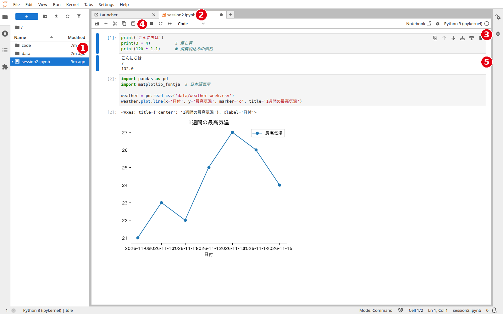
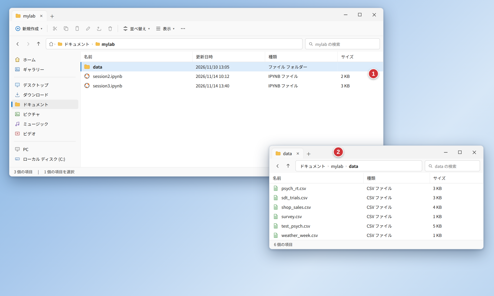

# 第2コマ　Python開発環境の構築

```{=html}
<div style="text-align: right; font-size: 0.8em; color: #666;">本資料（画像を含む）の無断転載・無断使用は禁止します．</div>
```


::: {.content-visible unless-format="revealjs"}
このコマの進め方：JupyterLab Desktop の準備（作業フォルダと日本語化）と画面説明（25分）→ 基本操作の実習とデータの配置（55分）→ まとめ（10分）。
このコマでは、実習のための環境（JupyterLab Desktop とデータ）を整えます。
:::

## JupyterLab Desktop の準備

- JupyterLab Desktop は、ノートブック（コードと結果を同じ画面で見ながら進める形式）を使うための無料ソフトです。**Python 本体が一緒に入っている**ので、Python を別に入れる必要はありません
- Windows へのインストールは、ターミナル（コマンド プロンプト）で次を実行してください

::: {.callout}
```text
winget install ProjectJupyter.JupyterLab
```
:::

- うまくいかない場合は、公式の配布ページ（github.com/jupyterlab/jupyterlab-desktop の Releases）からインストーラーをダウンロードしてください

## 作業フォルダ（ワーキングディレクトリ）の設定

- まず、講義用の作業場所（ワーキングディレクトリ）となるフォルダを、ドキュメント（マイドキュメント）の中に作ります。名前は例として **mylab** とします
- JupyterLab Desktop を起動し、右上のハンバーガーメニュー（≡）から **Settings** を選び、**Default working directory** に、作った mylab のフォルダを指定します
- これからの実習は、この mylab の中で進めます。ノートブックも実習データも、mylab の中に置きます

## 日本語化

- mylab の中に新しいノートブックを開き、セルで次を実行してください

::: {.callout}
```{python}
#| eval: false
%pip install jupyterlab-language-pack-ja-JP
```
:::

- 実行が終わったら、JupyterLab を再起動します
- 再起動したら、メニューの **Settings → Language** を開き、**「Japanese (Japan) – 日本語（日本）」**を選びます
- 確認が出たら **「Change and reload」**を押します。画面が再読み込みされて、日本語表示になります
- 再起動だけでは日本語にはなりません。言語パックのインストールと、この言語の選択の両方が必要です
- なお、パッケージの導入（pandas・matplotlib-fontja）は第3コマで別に案内します。ここでは日本語化だけを行います

## JupyterLab の画面



1. **ファイルブラウザ**（左側）。開いたフォルダの中のフォルダとファイルの一覧です。ファイルを選んで開きます
2. **ランチャー／タブ**。ランチャーからは新しいノートブックを作れます。タブには、開いているノートブックの名前が出ます
3. **ノートブックのセル**。コードを書く欄です。セル（枠）ごとに区切って書きます
4. **実行ボタン**（▶）。選んでいるセルを実行します（キーボードの Shift+Enter でも同じです）
5. **出力**。実行結果やグラフは、セルのすぐ下に表示されます

（上の図は実際の画面です。JupyterLab Desktop でも同じ画面構成です。なお、この図は日本語化する前の画面のため、メニューが英語になっています。日本語化しても画面の構成は同じです）

## 基本の使い方：4つのステップ

1. **セルに書く**：セル（コードを書く欄）にプログラムを書く
2. **実行する**：Shift+Enter（または実行ボタン ▶）。結果がセルの下に出て、次のセルに進みます
3. **セルを足す**：続きは新しいセルに書く（ツールバーの「＋」ボタン）。セルごとに実行できるので、少しずつ試せます
4. **保存する**：Ctrl+S。ノートブックのファイルの末尾は `.ipynb` になります（例：`session2.ipynb`）

エラー（赤い文字）が出たら、セルの下に表示されるメッセージの**一番下の行**がヒントです。グラフも、セルの下にそのまま表示されます。

## データのダウンロード（実習の前に）

- 実習で使うデータは、あらかじめ固めてある **data.zip をダウンロード**してください
- 配布ページ（data.zip）：https://github.com/helmenov/lecture-dataviz/blob/main/data.zip
- ページ右側のダウンロードボタンで落とし、**展開（解凍）すると data フォルダが出てきます**
- **置き場所**：作業フォルダ **mylab** の中に置きます



1. **data フォルダ**（赤い丸 1）。ダウンロードした data.zip を展開して出てくるフォルダです。mylab の中に置きます
2. **data フォルダの中身**（赤い丸 2）。開くと、実習で使う csv ファイルが入っています

（この図は、エクスプローラーの画面を再現したイメージ図です。実際の画面と細部が少し違うことがあります。ノートブック（session2.ipynb など）は、自分で mylab の直下に作ります）

- ノートブックは mylab の**直下**に作ってください。プログラムは、同じフォルダの中の data フォルダからデータを読みます。**置く場所を変えると、データが見つからずエラーになります**
- zip で配られている場合は、展開（解凍）してから置いてください。ダウンロードフォルダに置いたままにしないこと
- テスト用のデータ（test_psych.csv）も data フォルダに入っています。第8コマで使います

## 最初の試し実行

環境が整ったか、4つのステップで短いプログラムをセルで実行して確かめましょう。

::: {.callout}
```{python}
print('こんにちは')
print(3 + 4)          # 足し算
print(120 * 1.1)      # 消費税込みの価格
```
:::

（本の中では、このようなプログラムの実行結果もその場で表示されます）

## まとめ

- JupyterLab Desktop の準備ができました。操作は「セルに書く → Shift+Enter で実行する → セルを足して続きを書く → 保存する」の4ステップです
- 作業フォルダは mylab です。日本語化は、言語パックのインストールと、Settings → Language での「Japanese (Japan) – 日本語（日本）」の選択の両方が必要です
- 実習データ（data フォルダ）は mylab の中に置き、ノートブックは mylab の直下に作ります。置く場所を変えるとエラーになります
- 次のコマでは、プログラムの基本（変数・リスト・繰り返しなど）を学びます
