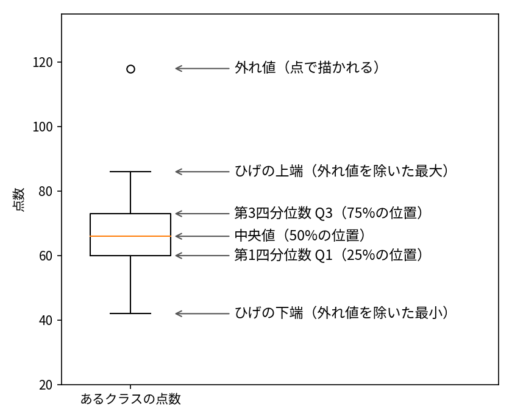

# 第5コマ　グラフのいろいろ・伝わるデザイン・グラフ作成

::: {.content-visible unless-format="revealjs"}
このコマの進め方：講義（40分）→ 一緒に実習（35分）→ 演習と振り返り（15分）。
グラフは pandas の plot で描きます（裏側では matplotlib が動いています）。表示と仕上げだけ matplotlib を使います。日本語表示は matplotlib-fontja です。
:::

```{python}
#| echo: false
import matplotlib.pyplot as plt
import numpy as np
import pandas as pd
# 日本語表示(matplotlib-fontja が使えない環境では、入っている日本語フォントを探す)
import matplotlib
try:
    import matplotlib_fontja  # noqa: F401
except Exception:
    from matplotlib import font_manager
    _fonts = {f.name for f in font_manager.fontManager.ttflist}
    for _n in ["IPAexGothic", "Noto Sans CJK JP", "Noto Sans JP",
               "Yu Gothic", "Meiryo", "Hiragino Sans"]:
        if _n in _fonts:
            matplotlib.rcParams["font.family"] = _n
            break
matplotlib.rcParams["axes.unicode_minus"] = False

days = ["月", "火", "水", "木", "金", "土", "日"]
temp = pd.Series([21, 23, 22, 25, 27, 26, 24], index=days)
sales = pd.Series([120, 85, 64, 42],
                  index=["コーヒー", "紅茶", "ジュース", "水"])
rng = np.random.default_rng(42)
study = pd.DataFrame({"勉強時間": rng.uniform(0, 8, 40)})
study["点数"] = np.clip(35 + 8 * study["勉強時間"] + rng.normal(0, 8, 40), 0, 100)
heights = pd.Series(rng.normal(162, 8, 200))
scores = pd.DataFrame({
    "A組": rng.normal(65, 10, 40),
    "B組": rng.normal(72, 7, 40),
    "C組": rng.normal(58, 14, 40),
})
```

## グラフは「知りたいこと」で選ぶ

| 知りたいこと | 合うグラフ |
|---|---|
| 時間とともにどう変わったか | 折れ線グラフ |
| 量を比べたい（名義・順序） | 棒グラフ |
| 2つの量に関係があるか | 散布図 |
| ばらつき・偏りを見たい | ヒストグラム |
| 複数のグループの分布を比べたい | 箱ひげ図 |
| 全体の中の割合 | 円グラフ／100%積み上げ棒（注意あり） |

第3コマの尺度とセットで考えます。「格好いいから」ではなく「質問に答える形」を選ぶのが原則です。

## 各グラフは「何の、どんな様子」を見せるか

| グラフ | 何の、どんな様子を見せたいときに使うか |
|---|---|
| 棒グラフ | カテゴリごとの**量の大きさ**。「どのカテゴリが、どれくらい大きいか」の様子 |
| ヒストグラム | 1つの量の**分布の形**。「どこに集まり、どう偏り、山はいくつか、飛び抜けた値はないか」の様子 |
| 箱ひげ図 | 複数のグループの**分布の要約**。「中心はどこか、広がりはどうか、外れ値はあるか」をグループごとに比べる様子 |
| 折れ線グラフ | 時間とともに量が**どう変化したか**。「増えた・減った・横ばいか、ピークはいつか」の様子 |
| 散布図 | 2つの量の**関係**。「一方が大きいとき、もう一方も大きいか（右上がり／右下がり／無関係）、点はどう集まり、外れ値はないか」の様子 |

描く前に「何の、どんな様子を見せたいのか」を一言で言えることが、グラフ選びの出発点です。

## pandas のグラフは「表から直接」

表（DataFrame）の `.plot` に種類（line、bar、scatter など）を指定するだけです。仕上げは matplotlib が担います。

## 折れ線・棒・散布図

```{python}
temp.plot.line(marker="o", title="週の後半に暑くなった", ylabel="最高気温(℃)")
plt.grid(alpha=0.3)
plt.show()
```

---

```{python}
sales.plot.bar(color="#4C78A8", title="売上の中心はコーヒー", ylabel="杯数")
plt.show()
```

---

```{python}
study.plot.scatter(x="勉強時間", y="点数", color="#F58518",
                   title="勉強時間とテストの点数")
plt.show()
```

::: {.callout-note}
円グラフは角度が読みにくいので注意が必要です。3Dグラフは、奥行きで値が読みにくいのでこの講座では扱いません。
:::

## ヒストグラム：分布の形を見る

```{python}
heights.plot.hist(bins=12, color="#54A24B", edgecolor="white",
                  title="受講生200人の身長の分布", xlabel="身長(cm)")
plt.show()
```

## 箱ひげ図：分布を要約して比べる

```{python}
scores.boxplot()
plt.title("クラスごとのテストの点数")
plt.ylabel("点数")
plt.show()
```

### 四分位数：データを小さい順に「4つに分ける」

箱ひげ図の中身は「四分位数」です。データ全体の真ん中50%が箱に入ります。

- データを小さい順に並べたとき、下から25%の位置が **第1四分位数（Q1）**、50%が**中央値**、75%が**第3四分位数（Q3）**
- 箱の幅 Q3 − Q1 を**四分位範囲（IQR）**と呼びます。真ん中50%の広がりです
- `describe()` の 25%・50%・75%（第4コマ）に出ていた、あの行がそのまま箱の上下と中央の線になります
- なお、位置の決め方には流儀があり、手計算とソフトで少しずれることがあります



### 箱ひげ図の描き方

1. データを小さい順に並べ、四分位数（Q1・中央値・Q3）を求める
2. Q1 から Q3 までを箱で囲み、中央値に線を引く（太線）
3. 「ひげ」は、箱から 1.5×IQR 以内にある最も端のデータまで伸ばす
4. それより外の点は、1つずつ点で描く（外れ値）

### 外れ値（ハズレ値）：飛び抜けた点の扱い

- 箱ひげ図で、ひげの外に点で描かれる値が外れ値です
- 目安は数式でも定義されます：Q1 − 1.5×IQR より小さい、または Q3 ＋ 1.5×IQR より大きい
- 外れ値は「間違い」と決めつけず、まず理由を調べます（入力ミスか、本当は特別な事情か）
- 消すのはその後。理由なく消すと、分析の結論がゆがみます

---

```{python}
one_class = pd.Series([42, 48, 52, 55, 57, 58, 60, 61, 62, 63, 64, 65, 66,
                       67, 68, 69, 70, 71, 73, 75, 77, 79, 82, 86, 118])
q1 = one_class.quantile(0.25)
med = one_class.median()
q3 = one_class.quantile(0.75)
iqr = q3 - q1
print(f"Q1={q1}, 中央値={med}, Q3={q3}, IQR={iqr}")
lo, hi = q1 - 1.5 * iqr, q3 + 1.5 * iqr
print("外れ値の候補:", one_class[(one_class < lo) | (one_class > hi)].tolist())
plt.figure()
one_class.plot.box()
plt.show()
```

## 伝わるデザインの約束

- 軸は原則 **0 から**（途中から始めると、差が実際より大きく見えます）
- タイトルは「何の図か」＋できれば**主張を一言**
- 単位と件数を添える
- 色は少なく。強調したい所だけ色を付ける
- 飾り（影、立体、グラデーション）は付けない

```{python}
vals = pd.Series([98, 100], index=["A店", "B店"])
fig, axes = plt.subplots(1, 2, figsize=(7.2, 3.2))
vals.plot.bar(ax=axes[0], color="#E45756", ylim=(90, 102), title="悪い例:軸が90から")
vals.plot.bar(ax=axes[1], color="#4C78A8", ylim=(0, 110), title="良い例:軸は0から")
plt.tight_layout()
plt.show()
```

---

```{python}
sales.plot.bar(color=["gray", "gray", "#E45756", "gray"],
               title="ジュースの売上が伸びている", ylabel="杯数")
plt.show()
```

---

```{python}
ax = temp.plot.line(marker="o", title="週の後半に暑くなった", ylabel="最高気温(℃)")
ax.annotate("今週の最高", xy=(4, 27), xytext=(2, 28),  # 位置は左から数えた番号(月=0…金=4)
            arrowprops=dict(arrowstyle="->"))
plt.show()
```

## 並べて比べる

```{python}
fig, axes = plt.subplots(2, 2, figsize=(8, 6))
temp.plot.line(ax=axes[0, 0], marker="o", title="最高気温(折れ線)")
sales.plot.bar(ax=axes[0, 1], color="#4C78A8", title="飲み物の売上(棒)")
study.plot.scatter(ax=axes[1, 0], x="勉強時間", y="点数", s=14,
                   color="#F58518", title="勉強時間と点数(散布)")
heights.plot.hist(ax=axes[1, 1], bins=12, color="#54A24B",
                  title="身長の分布(ヒスト)")
plt.tight_layout()
plt.show()
```

## 演習

1. お題（出席率の変化／満足度の偏り／身長と体重の関係）に合う形を描きましょう
2. 軸が90からの棒グラフを、0からに直しましょう
3. タイトルを「結論を書く形」に書き換えましょう

## まとめ

- グラフは「知りたいこと」で選ぶ。各グラフは「何のどんな様子」を見せるためのものか言えること
- 箱ひげ図は四分位数の図。外れ値は、理由を調べてから扱う
- pandas の .plot で描き、matplotlib で仕上げる
- デザインの約束：軸は0から、タイトル＝主張、単位と件数、色は少なく
