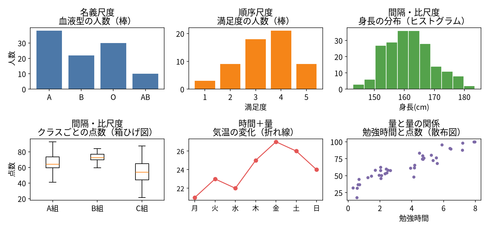

# 第5コマ　データ変数の尺度、Python言語の変数型タイプ

```{=html}
<div style="text-align: right; font-size: 0.8em; color: #666;">本資料（画像を含む）の無断転載・無断使用は禁止します．</div>
```


::: {.content-visible unless-format="revealjs"}
このコマの進め方：講義（45分）→ 一緒に実習（30分）→ 演習と振り返り（15分）。
:::

```{python}
#| echo: false
import pandas as pd
# 日本語表示(matplotlib-fontja が使えない環境では、入っている日本語フォントを探す)
import matplotlib
try:
    import matplotlib_fontja  # noqa: F401
except Exception:
    from matplotlib import font_manager
    _fonts = {f.name for f in font_manager.fontManager.ttflist}
    for _n in ["IPAexGothic", "Noto Sans CJK JP", "Noto Sans JP",
               "Yu Gothic", "Meiryo", "Hiragino Sans"]:
        if _n in _fonts:
            matplotlib.rcParams["font.family"] = _n
            break
matplotlib.rcParams["axes.unicode_minus"] = False
```

## データ集めの主な方法

- **調査（アンケート）**：聞いて集める。質問の書き方で答えが変わる点に注意
- **観察・記録**：出来事をそのまま記録する。測り方をそろえることが大事
- **実験**：条件を変えて結果を比べる。比べる相手（対照）を用意する
- **既存データ**：公的な統計や、業務でたまったデータを使う。元の集め方を確認する

## 「度量衡」という言葉について

このコマで出てくる「度量衡（どりょうこう）」は、昔からの「測るための共通のものさし」のことです。

- 度（ど）＝長さ、量（りょう）＝かさ（体積）、衡（こう）＝重さ
- 今で言えば、メートル・リットル・グラムといった**単位の体系そのもの**
- この後の「比尺度」の正体は、この度量衡です。「誰がどこで測っても同じになる単位で測った数値」とつながります

## 変数と尺度：データには「ものさし」がある

- 変数とは、測ったり記録したりする項目のこと（身長、満足度、血液型、気温…）
- 尺度とは、その変数がどんな性質の「ものさし」で測られているか、という区別です
- 尺度が違うと、**やってよい計算や、合うグラフが変わります**

| 尺度 | 例 | イメージ |
|---|---|---|
| 名義尺度 | 血液型、商品名、天気 | 名札。区別だけ |
| 順序尺度 | 順位、混雑具合、言葉の満足度（不満〜満足） | 順番はあるが間隔は不ぞろい |
| 間隔尺度 | 気温（℃）、西暦、数値化した満足度 | 間隔は均等。0は「無」ではない |
| 比尺度 | 身長、金額、個数 | 度量衡（長さ・重さなどの共通単位）。0＝本当に無い |

## 尺度で「できること」が違う

| 尺度 | 数える・割合 | 順位 | 差を言う（較べる） | 倍率を言う（比べる） | 平均 |
|---|---|---|---|---|---|
| 名義 | できる | できない | できない | できない | できない |
| 順序 | できる | できる | できない | できない | 注意 |
| 間隔 | できる | できる | できる | できない | できる |
| 比 | できる | できる | できる | できる | できる |

- 差を言う場合（気温）：較べる。5℃差と5℃差は同じ
- 倍率を言う場合（重さ）：比べる。「2倍重い」が言える
- 間隔尺度では、倍率は言えません（20℃は10℃の「2倍暑い」ではない）
- 度量衡でない数値データ（満足度など感覚を数値化したもの）も、**間隔尺度として扱います**。満足度は平均も使いますが、「4点は2点の2倍満足」とは言えません

### 数字でも、名義尺度として扱うもの

- 背番号、郵便番号、商品コードのように、順序の意味（大小・強弱・優劣）がない数値は、**数字符号**として名義尺度扱いです

## 水準と選択肢

- **水準**：変数が取りうる値のこと。天気なら「晴れ・くもり・雨」が水準です
- **選択肢**：調査で答えてもらうために用意する水準の並び
- 選択肢の約束：もれがない（「その他」を用意）、重ならない、順序のあるものは順序を保つ
- 文字列の水準でも順序があれば順序尺度（例：順位、混雑具合、言葉の満足度）。数値に割り振り直せば、間隔尺度として扱ってよい

## 標本という考え方

- 本当に知りたい全体を**母集団**、実際に集めたデータを**標本（サンプル）**と言います
- 講座のデータも、たいていは標本です（例：来場者全員ではなく、協力してくれた80名）
- 結論はまず、「この標本では、こう見えた」と言える範囲に置くのが安全です
- 標本の偏り（若い人ばかり、協力的で元気な人ばかり等）があると、全体の姿とずれることがあります

## 尺度とグラフの相性（目安）

| 尺度 | 合うグラフ | 例 |
|---|---|---|
| 名義 | 棒グラフ（人数・割合） | 血液型ごとの人数 |
| 順序 | 棒グラフ（人数・割合） | 満足度ごとの人数 |
| 間隔・比 | ヒストグラム／箱ひげ図／折れ線／散布図 | 身長の分布、気温の変化 |

読み取りのポイント：**名義・順序は「人数を数えて棒グラフ」。平均の棒グラフにはしません**。間隔・比は分布を見るヒストグラムや箱ひげ図が使えます。



## 実習：データを読み込んで、列の尺度を考える

- pandas で読み込んだデータは，`print()` ではなく `display()`の方が読みやすい（整形されます）．

::: {.callout}
```{python}
survey = pd.read_csv("data/survey.csv")
display(survey.head())
display(survey["年代"].unique())        # 水準を取り出す
display(survey["満足度"].value_counts())
```
:::

列ごとに「これは何尺度か」を言えるようにしておきましょう。

## データの型：Pythonの変数型とpandasのdtype

- Python の変数には「型」があります。第3コマで見たように、数値のリテラルと「カッコ付き文字列」のリテラルは、別の型として扱われます
- pandas では列ごとに型が決まっていて、**dtype** と呼びます。第4コマで `display(weather.dtypes)` としたときに出てきたのが、各列の dtype です

::: {.callout}
```{python}
display(survey.dtypes)    # 各列の型(dtype)
```
:::

- 文字列の列は object、整数の列は int64、小数を含む列は float64 のように表示されます
- 型が違うと、できることが違います。文字列の列には平均は出せません。逆に、数値の列でも、数字符号（名義尺度）のような列は、平均しても意味がありません
- 尺度と dtype は、どちらも「その列で何をしてよいか」を教えてくれる手がかりです

## 演習

1. 身の回りのデータを3つ挙げ、それぞれの尺度を答える
2. 次のデータはどの尺度か：背番号、気温、血液型、満足度（1〜5点）、身長、順位
   - 背番号：名義（数字符号）。気温：間隔。満足度（数値）：間隔として扱う。順位：順序
3. アンケートの選択肢を1つ作り、「もれ・重なり・順序」の点検をする

## まとめ

- 尺度は4つ（名義・順序・間隔・比）。比尺度の正体は度量衡
- 尺度によって、できる計算と合うグラフが決まる
- データは標本。結論は「この標本ではこう見えた」から始める
